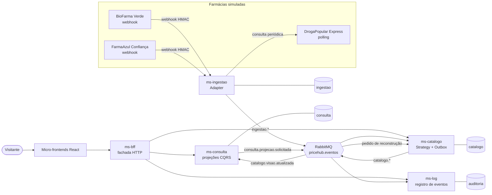
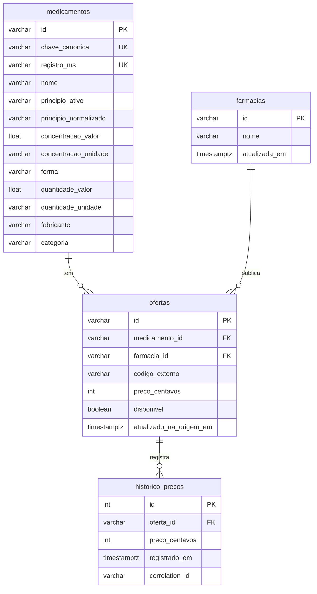
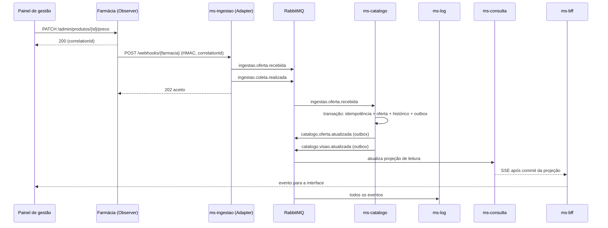

# Guia de ajustes no Overleaf

Este guia cruza três fontes: a reunião gravada com o orientador (transcrição), os comentários da
orientadora no `PriceHub.docx` e o PDF atual (versão de 06/11, 51 páginas). Para cada capítulo há
o que falta, por que falta e um trecho LaTeX pronto para colar e **reescrever com as palavras do grupo**.

> O professor foi explícito: pode usar IA como ferramenta, mas o texto tem de ser do grupo e toda
> afirmação precisa de uma fonte. Os trechos abaixo são rascunhos para adaptar, não para colar sem ler.
> Eles já evitam o travessão longo (—), que a orientadora apontou como marca de texto gerado.

Ordem sugerida: 1) preâmbulo e formatação, 2) Capítulo 4 (descreve o código novo), 3) Capítulo 5
(precisa rodar o sistema), 4) Capítulo 6 e Apêndice, 5) Resumo e Introdução por último.

---

## 0. O que mudou no código e afeta o texto

O backend foi reescrito em **Python (FastAPI)**, seguindo a orientação de microsserviços e eventos. O texto do
PDF ainda descreve só dois serviços e cita Prisma. Agora são:

| Componente | Papel | Banco próprio |
|---|---|---|
| `ms-ingestao` | Webhooks, polling, **Adapter**, publica `ingestao.*` | `ingestao` |
| `ms-catalogo` | Consome a ingestão, **Strategy** de correspondência, histórico imutável, **outbox**, publica snapshots | `catalogo` |
| `ms-consulta` | Projeções de leitura CQRS atualizadas por eventos; busca, histórico e SSE | `consulta` |
| `ms-bff` | Fachada HTTP usada pelos micro-frontends; encaminha cada operação ao serviço responsável | - |
| `ms-log` | **Serviço de log** pedido pelo professor: assina todos os eventos, rastreia, mede | `auditoria` |
| `farmacia-*` (3 instâncias) | Farmácias simuladas com **Observer**, dados em memória | nenhum |
| Frontend | React + Tailwind, 4 micro-frontends num monorepositório | - |

Consequências diretas no texto:

* Trocar toda menção a **Prisma** e **Node/Fastify** (inclusive dentro da Figura 4).
* Tirar **"RabbitMQ / Kafka"** da Figura 3 e das páginas 35 e 36: a solução usa só RabbitMQ. Kafka continua
  aparecendo apenas na teoria (Seção 2.4) como contraste, o que está correto.
* A Seção 4.1.7 (serviço de log) deixa de ser promessa: o `ms-log` existe e é a fonte do Capítulo 5.
* O padrão **Observer** passa a estar implementado nas farmácias, como o professor sugeriu.

---

## 1. Preâmbulo e formatação (comentários da orientadora)

Atenção: o resumo gerado pelo Gemini em 04/11 diz "aplicar letras minúsculas nos títulos". A regra
da orientadora (comentário 15 do docx) é outra:

* seção primária (1, 2, 3): **CAIXA ALTA e negrito**, fonte 12;
* seção secundária (2.1): **CAIXA ALTA sem negrito**, fonte 12;
* seção terciária (2.5.1): **negrito**, maiúscula só na primeira palavra (e nomes próprios).

No preâmbulo (depois de `\usepackage{abntex2}` ou do arquivo de configuração do template):

```latex
% Títulos conforme orientação (comentários 13 a 22 e 47 a 49).
% O abntex2 decide a caixa alta por booleanos (equivalem às opções chapter=TITLE e section=TITLE da classe).
\setboolean{ABNTEXupperchapter}{true}
\setboolean{ABNTEXuppersection}{true}
\setboolean{ABNTEXuppersubsection}{false}
\renewcommand{\ABNTEXchapterfont}{\normalfont\bfseries}
\renewcommand{\ABNTEXchapterfontsize}{\normalsize}
\renewcommand{\ABNTEXsectionfont}{\normalfont}
\renewcommand{\ABNTEXsectionfontsize}{\normalsize}
\renewcommand{\ABNTEXsubsectionfont}{\normalfont\bfseries}
\renewcommand{\ABNTEXsubsectionfontsize}{\normalsize}
% Recuo de parágrafo 1,25 cm (comentário 27)
\setlength{\parindent}{1.25cm}
% Listas a), b), c) e 1), 2) sem negrito (comentários 63 e 71)
\usepackage{enumitem}
\setlist[enumerate,1]{label=\alph*), leftmargin=*, font=\normalfont}
\newlist{numerada}{enumerate}{1}
\setlist[numerada]{label=\arabic*), leftmargin=*, font=\normalfont}
% Legendas de figura e fonte em tamanho 11, título centralizado e fonte sem itálico (comentários 89 e 90)
\usepackage{caption}
\captionsetup{font=small, justification=centering, labelsep=endash}
```

Se o template da UCSal já redefinir esses comandos, altere lá mesmo em vez de duplicar.

Checklist de formatação:

- [ ] Itens de lista começam com **minúscula** e terminam em `;` (o último em `.`). Ex.: Cap. 1 (p. 13), 2.2 (p. 16), 2.3 (p. 19), 2.4 (p. 21), 2.5.2 (p. 24), 4.1.5 (p. 38).
- [ ] Trocar marcadores de bolinha por `a)`, `b)`, `c)` (usar `enumerate`, não `itemize`). Hoje 4.1.1, 4.1.4, 4.1.6, 4.2.1 e 4.2.2 usam bolinha.
- [ ] Buscar e substituir `—` por `--` (no Overleaf: Ctrl+F com o caractere colado).
- [ ] Toda figura: título acima e centralizado; abaixo `\fonte{Autoria própria.}` (ou `\legend{Fonte: Autoria própria.}`), tamanho 11, sem itálico. Figuras adaptadas: `\fonte{Adaptado de \citeonline{fowler2014}.}`.
- [ ] Toda figura e tabela citada no texto **antes** de aparecer ("Conforme a Figura~\ref{fig:conteineres}...").
- [ ] Siglas: na primeira ocorrência por extenso seguida da sigla entre parênteses (comentário 87).
- [ ] Lista de siglas: incluir AMQP, DLQ, EDA, HMAC, HTTP, SSE, SQL e ETag; corrigir PMC e RDC "grudadas" (cada uma em seu `\item[PMC]{...}`).
- [ ] Autores citados no texto em caixa baixa ("Segundo Fowler e Lewis (2014)"), sem parênteses extras (comentário 74).
- [ ] Corrigir "Capítulo ??" (p. 30) e "Seção 4" (p. 28) usando `\label`/`\ref` (ver Capítulo 3 abaixo).
- [ ] "Richardson (2018) apontam" (p. 15): um autor, verbo no singular ("aponta").

---

## 2. Resumo e Abstract

O resumo atual fala só do Adapter e de "testes funcionais". Falta o que o trabalho de fato estuda:
microsserviços, eventos, RabbitMQ e a validação por logs. Rascunho (ajustar números com a sua execução):

```latex
\begin{resumo}
A comparação de preços entre lojas virtuais exige integrar fontes independentes, que publicam dados em formatos
diferentes e mudam seus valores a qualquer momento. Este trabalho investiga como uma arquitetura de microsserviços
com comunicação assíncrona orientada a eventos atende a esse problema, usando como objeto de estudo o PriceHub, um
agregador de preços de medicamentos. A solução usa serviços independentes, com bancos próprios para ingestão,
escrita do catálogo, projeções de leitura e auditoria, integrados por RabbitMQ. A ingestão aplica o padrão Adapter
para converter os formatos das fontes em um modelo canônico; o catálogo consome eventos de forma idempotente e
publica alterações e snapshots por meio do padrão Transactional Outbox; o serviço de consulta mantém projeções CQRS,
e o serviço de registro assina eventos para permitir o rastreamento. Uma fachada BFF encaminha as chamadas dos
micro-frontends sem compartilhar os bancos dos serviços. Como não há interfaces públicas e gratuitas de consulta de preços nas grandes
redes de farmácias, foram criadas três farmácias simuladas, que implementam o padrão Observer para notificar as
alterações. A validação, feita a partir dos registros do serviço de log, mostrou o catálogo vazio, a consolidação de
10 medicamentos vindos de três formatos distintos e a propagação de alterações de preço em [X] ms (mediana), sem
perda de mensagens mesmo com o serviço de catálogo indisponível. Conclui-se que a arquitetura desacopla as fontes
do núcleo do sistema, ao custo de maior complexidade operacional e de consistência eventual.

\textbf{Palavras-chave}: arquitetura de software. microsserviços. arquitetura orientada a eventos. mensageria. RabbitMQ.
\end{resumo}
```

Fazer o Abstract depois, traduzindo a versão final do resumo.

---

## 3. Capítulo 1: Introdução

Comentários da orientadora ainda não atendidos ou parcialmente atendidos:

| Comentário | O que pedir ao texto |
|---|---|
| 28 | Sustentar "crescimento do comércio eletrônico" com dado recente (ex.: relatório da ABComm ou Webshoppers/NielsenIQ do ano). |
| 30 | Explicar custo de busca com a dificuldade concreta: achar o mesmo medicamento em lojas diferentes e comparar preços equivalentes. Já está razoável; tirar adjetivos sem fonte. |
| 33 | Mostrar por que a regulação sanitária **não** resolve a assimetria de preço (o PMC é teto, não preço praticado). A frase atual liga as duas coisas sem argumento. |
| 37 | Dizer o que os agregadores fazem e se já existem para farmácias (ex.: Consulta Remédios, Cliquefarma). Se existem, o diferencial do TCC é a **arquitetura estudada**, não o produto. |
| 39 | Definir integrar, normalizar e centralizar; deixar claro que o trabalho **implementa um protótipo** e **avalia** por critérios verificáveis (ver Capítulo 3). |
| 41 | Contribuição social como possibilidade; dizer que as fontes são simuladas. (O PDF já faz isso no 3º parágrafo; manter.) |
| 42/43 | Medicamentos "mais consumidos", com fonte verificável (Anuário da Anvisa/CFF/InovaFarma), e não "essenciais". |

Objetivos específicos atualizados (substituir a lista atual, que fala só de Adapter e testes funcionais):

```latex
\begin{enumerate}
  \item estudar as arquiteturas monolítica, de microsserviços e orientada a eventos, e o papel de um broker de mensagens;
  \item projetar o PriceHub como um conjunto de microsserviços com bancos de dados próprios, comunicando-se por eventos publicados no RabbitMQ;
  \item implementar a ingestão de dados heterogêneos com o padrão Adapter e o catálogo centralizado com consumo idempotente e publicação por outbox;
  \item desenvolver três farmácias simuladas, com o padrão Observer, como fontes externas para a validação;
  \item implementar um serviço de registro de eventos e validar, a partir dos seus registros, a carga inicial, a propagação de alterações de preço e o comportamento diante da indisponibilidade do catálogo.
\end{enumerate}
```

Pergunta de pesquisa sugerida (mais próxima do título):

```latex
Diante disso, este trabalho busca responder: \textit{em que medida uma arquitetura de microsserviços com
comunicação assíncrona orientada a eventos permite integrar fontes heterogêneas de preços mantendo o catálogo
atualizado sem acoplar as fontes ao núcleo do sistema?}
```

---

## 4. Capítulo 2: Fundamentação teórica

O PDF de 06/11 já incorporou os quatro vídeos (Augusto 2024, 2025, 2026; Coelho 2026), retirou PriceHub e
medicamentos da teoria e refez os trabalhos relacionados. Pendências:

- [ ] **Figuras da teoria** (o professor pediu "demonstrar através de imagens"): só há a Figura 1. Sugestão mínima: uma figura do fluxo produtor → exchange → fila → consumidor (Seção 2.4) e uma do Observer (Seção 2.5.2), ambas "Adaptado de" Coelho (2026) e Gamma et al. (1994).
- [ ] **Subseção curta sobre garantias de entrega**, porque o Capítulo 4 usa idempotência, outbox, retry e DLQ e a teoria precisa sustentar isso. Texto-base:

```latex
\subsection{Garantias de entrega: idempotência e outbox}

Em sistemas distribuídos, a publicação de uma mensagem e a gravação no banco de dados são operações
independentes. \citeonline{richardson2018} descreve o problema da dupla escrita: se o serviço grava os dados e
falha antes de publicar o evento, os demais serviços nunca sabem da alteração; se publica antes de gravar, avisa
sobre algo que não aconteceu. O padrão \textit{Transactional Outbox} resolve esse problema gravando o evento em
uma tabela do próprio banco, na mesma transação dos dados, e publicando-o depois por um processo separado.

Como os \textit{brokers} garantem a entrega ao menos uma vez (\textit{at-least-once}), uma mesma mensagem pode
chegar mais de uma vez ao consumidor \cite{kleppmann2017}. Por isso o consumidor deve ser idempotente, isto é,
processar a mesma mensagem repetidas vezes sem alterar o resultado, o que costuma ser feito registrando o
identificador de cada evento já processado \cite{richardson2018}. Mensagens que falham repetidamente são
desviadas para uma fila de mensagens mortas (\textit{dead letter queue}), para não bloquear as demais e permitir
análise posterior \cite{hohpe2004}.
```

- [ ] **Micro-frontends** (opcional, uma frase): o frontend também foi dividido em aplicações independentes. Se citar, use Geers (2020), referência abaixo.

---

## 5. Capítulo 3: Metodologia

Já está em 3,5 páginas com os 4 itens obrigatórios. Ajustes:

```latex
% No início do capítulo 4 e do capítulo 5, crie os rótulos:
\chapter{Desenvolvimento da solução}\label{cap:desenvolvimento}
\chapter{Resultados}\label{cap:resultados}

% Na Seção 3.3, troque "Seção 4" por:
Seu detalhamento técnico encontra-se no Capítulo~\ref{cap:desenvolvimento}.

% Na Seção 3.5, troque "Capítulo ??" por:
o Capítulo~\ref{cap:resultados} apresenta a validação por meio de registros (\textit{logs}).
```

Acrescentar uma seção curta com os **critérios de avaliação** (comentário 39 da orientadora):

```latex
\section{Critérios de avaliação}

A validação do PriceHub será feita a partir dos registros do serviço de log, em quatro situações:
\begin{enumerate}
  \item catálogo vazio, antes de qualquer farmácia ser integrada;
  \item carga inicial, ao iniciar cada farmácia: espera-se que os 30 itens (10 por farmácia) resultem em 10 medicamentos únicos, cada um com 3 ofertas;
  \item alteração de preço em cada farmácia: espera-se que o novo valor chegue ao catálogo, com o mesmo identificador de correlação do início ao fim;
  \item indisponibilidade do catálogo: espera-se que as farmácias continuem sendo atendidas e que nenhuma alteração se perca.
\end{enumerate}
Em cada situação são medidos o tempo de aceite (quanto a farmácia espera) e a janela de convergência (tempo até o
catálogo refletir a alteração).
```

---

## 6. Capítulo 4: Desenvolvimento da solução

### 6.1 Abertura e regras de negócio
Já atende (p. 31). Só acrescentar uma regra que agora existe no código:

```latex
Uma oferta deixa de ser exibida como disponível quando a farmácia a remove ou quando ela não aparece em uma coleta
completa do catálogo daquela farmácia; o histórico dos preços anteriores é mantido.
```

### 6.2 Requisitos (comentários 84, 85 e 86)
A orientadora pediu: critério verificável para cada RNF e o significado das prioridades. Sugestão de texto antes
da Tabela 2 e nova Tabela 3:

```latex
A prioridade \textit{essencial} indica requisito sem o qual a hipótese do trabalho não pode ser avaliada;
\textit{alta} indica requisito necessário à validação, mas que não impede o funcionamento do fluxo principal.

\begin{table}[htbp]
\centering
\caption{Requisitos não funcionais e forma de verificação}
\label{tab:rnf}
\small
\begin{tabular}{p{1.5cm}p{5.5cm}p{6.5cm}}
\toprule
ID & Requisito & Como foi verificado \\
\midrule
RNF-01 & Desacoplamento: ingestão e catálogo comunicam-se só por eventos & nenhum serviço chama outro por HTTP; serviços com bancos separados \\
RNF-02 & Resiliência: a queda do catálogo não afeta as farmácias & experimento com o consumo pausado (Seção~\ref{sec:resiliencia}) \\
RNF-03 & Observabilidade: toda operação é rastreável & mesmo \textit{correlationId} da farmácia ao catálogo no ms-log \\
RNF-04 & Integridade: dados de formatos distintos associados ao mesmo medicamento & 10 medicamentos únicos a partir de 30 ofertas \\
RNF-05 & Facilidade de integração: nova fonte sem alterar o núcleo & cada farmácia é um adaptador; o ms-catalogo não conhece formatos \\
RNF-06 & Atualidade: a interface informa a data da última atualização & campo exibido em cada oferta \\
RNF-07 & Escalabilidade: escalar só o serviço sobrecarregado & filas monitoradas; escala testada como trabalho futuro \\
\bottomrule
\end{tabular}
\fonte{Autoria própria.}
\end{table}
```

### 6.3 Arquitetura (substituir 4.1.3 e as Figuras 2 e 3)

As figuras atuais têm "Kafka" e nomes do Prisma. Gere de novo a partir do Mermaid abaixo (cole em
https://mermaid.live, exporte em PNG ou SVG e suba no Overleaf como `figuras/conteineres.png`).



Texto da seção (adaptar):

```latex
\subsection{Modelagem arquitetural da solução}

A Figura~\ref{fig:conteineres} apresenta o diagrama de contêineres (nível 2 do Modelo C4) da solução. Os serviços
de domínio mantêm processos e bancos próprios: o \textit{ms-ingestao}, que recebe e padroniza dados; o
\textit{ms-catalogo}, responsável pelas escritas; o \textit{ms-consulta}, responsável por projeções CQRS; e o
\textit{ms-log}, que registra eventos. Os serviços de domínio não compartilham bancos e integram-se por eventos.
O \textit{ms-bff} é a borda HTTP do navegador e encaminha requisições às APIs responsáveis; não contém regras de
domínio nem lê bancos alheios. A projeção de leitura tem consistência eventual e pode pedir ao catálogo a
republicação dos snapshots se iniciar vazia.

\begin{figure}[htbp]
\centering
\caption{Diagrama de contêineres (Modelo C4, nível 2) do PriceHub}
\label{fig:conteineres}
\includegraphics[width=\textwidth]{figuras/conteineres.png}
\fonte{Autoria própria.}
\end{figure}

Os serviços foram implementados em Python com o \textit{framework} FastAPI \cite{fastapi2026}, que gera
automaticamente a especificação OpenAPI e uma página de documentação interativa em cada serviço. Os dados de
entrada são validados por modelos Pydantic \cite{pydantic2026}: requisições fora do contrato recebem resposta
422 com a lista de campos inválidos, no formato \textit{problem details} \cite{rfc9457}. A interface foi feita em
React \cite{react2026}, dividida em quatro aplicações independentes (comparador, gestão das lojas, monitor de
eventos e vitrines das farmácias) que compartilham apenas pacotes de código, em um único repositório.
```

### 6.4 Banco de dados (4.1.4 e Figura 4)

Os nomes do texto já estão certos; a Figura 4 ainda tem o cabeçalho "migrações Prisma". Nova figura:



Acrescentar ao texto (e corrigir o comentário 100, sobre "histórico imutável"):

```latex
O histórico de preços é cumulativo e \textit{append-only}: o serviço apenas insere novas linhas. Triggers no
PostgreSQL rejeitam operações \texttt{UPDATE} e \texttt{DELETE}, garantindo a imutabilidade também no banco.
Além das tabelas de negócio, o banco do catálogo tem três tabelas de apoio: \texttt{eventos\_processados}, que
garante a idempotência; \texttt{outbox}, com os eventos a publicar; e \texttt{ofertas\_nao\_correspondidas}, com as
ofertas que não puderam ser associadas a um medicamento. O \textit{ms-ingestao} mantém, em seu banco, a coleta
bruta recebida de cada farmácia, e o \textit{ms-log}, em banco próprio, um registro por evento.
```

### 6.5 Comunicação por eventos (4.1.5, comentário 101)

A orientadora pediu: quais eventos, quem produz, quem consome. Substituir a lista atual por esta tabela e pelo
texto abaixo.

```latex
\begin{table}[htbp]
\centering
\caption{Eventos publicados na exchange \texttt{pricehub.eventos}}
\label{tab:eventos}
\small
\begin{tabular}{p{5.2cm}p{2.3cm}p{6.5cm}}
\toprule
Evento & Produtor & Consumidores e efeito \\
\midrule
\texttt{ingestao.oferta.recebida} & ms-ingestao & ms-catalogo: cria ou atualiza a oferta; ms-log \\
\texttt{ingestao.oferta.removida} & ms-ingestao & ms-catalogo: marca a oferta como indisponível; ms-log \\
\texttt{ingestao.oferta.descartada} & ms-ingestao & ms-log: item fora do contrato \\
\texttt{ingestao.coleta.realizada} & ms-ingestao & ms-catalogo: retira ofertas ausentes; ms-log: tempo de aceite \\
\texttt{ingestao.farmacia.indisponivel} & ms-ingestao & ms-log \\
\texttt{catalogo.medicamento.cadastrado} & ms-catalogo & ms-log; interface (tempo real) \\
\texttt{catalogo.oferta.atualizada} & ms-catalogo & ms-log; interface (tempo real) \\
\texttt{catalogo.oferta.indisponivel} & ms-catalogo & ms-log; interface (tempo real) \\
\texttt{catalogo.oferta.nao-correspondida} & ms-catalogo & ms-log \\
\texttt{catalogo.visao.atualizada} & ms-catalogo & ms-consulta: atualiza a projeção; ms-log \\
\texttt{consulta.projecao.solicitada} & ms-consulta & ms-catalogo: republica snapshots após reconstrução; ms-log \\
\bottomrule
\end{tabular}
\fonte{Autoria própria.}
\end{table}
```

```latex
Todos os eventos são publicados em uma única \textit{exchange} do tipo \textit{topic}, chamada
\texttt{pricehub.eventos}, usando o nome do evento como chave de roteamento (Tabela~\ref{tab:eventos}). Cada
consumidor declara a sua fila e escolhe o que receber por padrões: o \textit{ms-catalogo} liga a fila
\texttt{ms-catalogo.eventos-de-ingestao} aos três eventos de ingestão que lhe interessam, enquanto o
\textit{ms-log} liga a fila \texttt{ms-log.todos-os-eventos} ao padrão \texttt{\#}, que recebe tudo. Assim o
produtor não sabe quantos consumidores existem, e o serviço de log foi incluído sem nenhuma alteração nos demais.

Todo evento segue o mesmo envelope, com identificador único, tipo, versão do contrato, instante de ocorrência,
serviço de origem, identificador de correlação e dados. O identificador de correlação nasce na requisição que
alterou o preço na farmácia, segue no cabeçalho do \textit{webhook} e é copiado para todos os eventos
derivados, o que permite reconstituir a operação inteira.

A mensagem só é removida da fila após a confirmação (\textit{ACK}) do consumidor. Se o processamento falhar, a
mensagem vai para uma fila de nova tentativa com espera de 2 segundos e volta à fila principal; após cinco
falhas, é desviada para a fila de mensagens mortas (\texttt{.dlq}). O \textit{ms-catalogo} aplica cada evento em
uma única transação que registra o identificador do evento (idempotência), altera os dados e grava os eventos de
saída na tabela \texttt{outbox}; um processo separado publica esses eventos no RabbitMQ.

Para evitar o envio de eventos desnecessários, o \textit{ms-ingestao} guarda uma assinatura de cada oferta já
publicada e só publica o que mudou; no \textit{polling}, usa o cabeçalho ETag e não processa o arquivo da farmácia
quando ele não foi alterado. A indisponibilidade de uma farmácia gera um único evento, na transição, e não um por
tentativa.
```

Figura recomendada: diagrama de sequência da alteração de preço (o repositório antigo tinha um; refazer):



### 6.6 Padrões e decisões (4.1.6, comentário 106)

Atualizar a lista de ADRs para as sete do Apêndice A (Seção 9 deste guia) e acrescentar:

```latex
Cada registro de decisão segue a estrutura proposta por \citeonline{nygard2011}: contexto, alternativas
consideradas, decisão e consequências. Os registros completos estão no Apêndice~\ref{ap:adrs}.

Além do Adapter e da publicação e assinatura, três padrões aparecem no código. O \textit{Template Method}
organiza a conversão nos adaptadores: a classe base define o algoritmo (validar cada item, adaptar, separar
os itens descartados) e cada farmácia implementa apenas os passos específicos \cite{gamma1994}. O
\textit{Strategy} define como uma oferta é associada a um medicamento: primeiro pelo registro na Anvisa e,
na ausência dele, pela chave canônica formada por princípio ativo, concentração, forma e quantidade. E o
\textit{Observer} é usado nas farmácias simuladas, descrito na Seção~\ref{sec:observer-farmacias}.
```

### 6.7 Serviço de log (4.1.7)

Reescrever no presente, porque agora existe:

```latex
O \textit{ms-log} assina todos os eventos e grava cada um no banco \texttt{auditoria}, com tipo, serviço de
origem, farmácia, identificador de correlação, instante de ocorrência e dados. Sobre esses registros oferece:
a consulta com filtros; a linha do tempo de uma operação a partir do identificador de correlação; o fluxo em
tempo real para o painel de monitoramento; e duas medidas usadas no Capítulo~\ref{cap:resultados}: o tempo de
aceite, informado pelo \textit{ms-ingestao} em cada coleta, e a janela de convergência, que vai do primeiro
evento da operação até o evento \texttt{catalogo.oferta.atualizada}. O serviço também lê a API de gerenciamento
do RabbitMQ para exibir quantas mensagens cada fila retém.
```

### 6.8 Farmácias (4.2) e Observer (4.2.5)

A Tabela 4 está certa (são os preços da carga inicial). Reescrever 4.2.5 com o Observer, que agora está no
código:

```latex
\subsection{Comunicação e disparo de eventos em memória}\label{sec:observer-farmacias}

Cada farmácia mantém seus produtos em memória, sem banco de dados: uma alteração vale imediatamente. O catálogo
da farmácia é o sujeito do padrão Observer \cite{gamma1994}: ao cadastrar, alterar o preço, editar ou remover
um produto, ele avisa todos os observadores anexados, sem conhecê-los. Dois observadores foram implementados:
um que registra a alteração no log da farmácia e outro que envia o \textit{webhook} ao PriceHub, no formato
próprio da farmácia e assinado com HMAC-SHA256 \cite{rfc2104}. O envio ocorre em segundo plano, para que a
farmácia não espere o PriceHub; se ele estiver indisponível, há novas tentativas com espera crescente e,
persistindo a falha, a sincronização periódica do \textit{ms-ingestao} recupera a diferença.

A DrogaPopular Express não tem observador de \textit{webhook}: representa um sistema legado que apenas publica
um arquivo de preços. A alteração muda a versão do catálogo, refletida no ETag, e é percebida na próxima
consulta do \textit{ms-ingestao}, a cada 15 segundos.
```

Quadro útil para a banca (os três formatos do mesmo produto, que justificam o Adapter):

```latex
\begin{table}[htbp]
\centering
\caption{O mesmo medicamento nos três formatos de origem}
\label{tab:formatos}
\footnotesize
\begin{tabular}{p{2.6cm}p{11cm}}
\toprule
Farmácia & Representação recebida \\
\midrule
BioFarma Verde & \texttt{\{"sku":"BIO-0002","nome":"Losartana Potássica","dosagem":"50mg",
"apresentacao":"30 comprimidos revestidos","preco":11.5\}} \\
FarmaAzul Confiança & \texttt{\{"codigo":"FA-LOS-50","concentracao":"50mg","forma\_farmaceutica":
"comprimido revestido","quantidade\_embalagem":30,"preco\_centavos":890\}} \\
DrogaPopular Express & \texttt{\{"COD":"DP-0002","DESCRICAO":"LOSARTANA POTASSICA 50MG C/30 COMP REV",
"PRECO":"7,49"\}} \\
\bottomrule
\end{tabular}
\fonte{Autoria própria.}
\end{table}
```

---

## 7. Capítulo 5: Resultados (novo)

Este capítulo não existe no PDF. O professor descreveu exatamente o que quer: PriceHub vazio, a chegada de cada
farmácia e a alteração de preço, tudo provado pelo log. Siga o roteiro do `README.md` e use os prints da pasta
`docs/telas` como referência (mas tire os seus, da sua execução). O script `scripts/validacao_ponta_a_ponta.py`
gera os números e os JSON para cada etapa.

Os números entre colchetes são da execução de exemplo em `docs/evidencias/exemplo-execucao-local/` e **devem ser
substituídos** pelos da execução do grupo.

Dois detalhes de LaTeX: o ambiente `quadro` existe em muitos templates abntex2 de universidades; se o seu não
tiver, troque por `figure`. O `lstlisting` precisa de `\usepackage{listings}` no preâmbulo.

```latex
\chapter{Resultados}\label{cap:resultados}

Este capítulo apresenta a validação do PriceHub conforme os critérios definidos no Capítulo 3. Todas as
evidências vêm dos registros do \textit{ms-log}, que assina os eventos publicados no RabbitMQ, e das APIs dos
microsserviços. A execução foi feita com os contêineres descritos no Capítulo~\ref{cap:desenvolvimento}, em um
único computador [descrever: processador, memória, sistema operacional, Docker Desktop].

\section{Etapa 1: PriceHub sem farmácias}

Inicialmente foram iniciados o RabbitMQ, o PostgreSQL, os serviços do PriceHub e a interface.
A Figura~\ref{fig:vazio} mostra o comparador sem nenhum medicamento, e a consulta às estatísticas do catálogo
retornou zero medicamentos, farmácias e ofertas. O \textit{ms-ingestao} registrou as três farmácias como
indisponíveis e publicou um único evento \texttt{ingestao.farmacia.indisponivel} para cada uma.

\begin{figure}[htbp]
\centering
\caption{Comparador com o catálogo vazio}
\label{fig:vazio}
\includegraphics[width=0.85\textwidth]{figuras/resultado-01-vazio.png}
\fonte{Autoria própria.}
\end{figure}

\section{Etapa 2: carga inicial das farmácias}

Em seguida, as farmácias foram iniciadas uma de cada vez. Ao subir, cada farmácia carrega a sua carga inicial
e o observador de \textit{webhook} envia o catálogo completo ao PriceHub. O Quadro~\ref{qua:log-carga} mostra o
registro da coleta da BioFarma Verde: 10 itens recebidos, 10 ofertas publicadas e tempo de aceite de [25] ms.

\begin{quadro}[htbp]
\centering
\caption{Registro da carga inicial da BioFarma Verde no ms-log}
\label{qua:log-carga}
\begin{lstlisting}[basicstyle=\scriptsize\ttfamily, breaklines=true]
tipo: ingestao.coleta.realizada   servico: ms-ingestao   farmacia: biofarma
origem: webhook   itensRecebidos: 10   ofertasPublicadas: 10   descartadas: 0
duracaoMs: [25.13]   correlationId: [fa7c368c-b77b-432f-b37c-dcfba6b56b71]
\end{lstlisting}
\fonte{Autoria própria.}
\end{quadro}

Após as três farmácias, o catálogo passou a ter 10 medicamentos, cada um com 3 ofertas, embora os dados tenham
chegado em três formatos distintos (Tabela~\ref{tab:formatos}). Nenhuma oferta ficou sem correspondência. A
Tabela~\ref{tab:consolidado} apresenta o resultado da consolidação.

\begin{table}[htbp]
\centering
\caption{Catálogo consolidado após a carga inicial}
\label{tab:consolidado}
\small
\begin{tabular}{p{5.5cm}rlr}
\toprule
Medicamento & Menor preço & Farmácia mais barata & Maior preço \\
\midrule
Cloridrato de Metformina 500 mg & R\$ 9,99 & DrogaPopular Express & R\$ 14,90 \\
% ... demais linhas copiadas do resumo.md da etapa 2 gerado pelo script
\bottomrule
\end{tabular}
\fonte{Autoria própria.}
\end{table}

\section{Etapa 3: alteração de preço}

Com o catálogo carregado, o preço de um produto foi alterado em cada farmácia pelo painel de gestão. A
Figura~\ref{fig:propagacao} mostra a tela no momento da alteração: à direita, os eventos chegam em tempo real.
A Tabela~\ref{tab:propagacao} resume a linha do tempo de cada operação, obtida no \textit{ms-log} pelo
identificador de correlação.

\begin{table}[htbp]
\centering
\caption{Propagação de uma alteração de preço por farmácia}
\label{tab:propagacao}
\small
\begin{tabular}{p{2.8cm}p{2.2cm}p{5.6cm}p{2.6cm}}
\toprule
Farmácia & Integração & Eventos & Até o catálogo \\
\midrule
BioFarma Verde & \textit{webhook} & oferta recebida, coleta realizada, oferta atualizada & [12,5] ms \\
FarmaAzul Confiança & \textit{webhook} & oferta recebida, coleta realizada, oferta atualizada & [16,3] ms \\
DrogaPopular Express & \textit{polling} & oferta recebida, coleta realizada, oferta atualizada & [13,3] ms após a consulta \\
\bottomrule
\end{tabular}
\fonte{Autoria própria.}
\end{table}

Na DrogaPopular, que não envia \textit{webhook}, a alteração só é percebida na consulta seguinte (até 15 s);
depois disso, a propagação interna leva o mesmo tempo das demais.

\section{Indisponibilidade do catálogo}\label{sec:resiliencia}

Para verificar o desacoplamento temporal, o consumo do \textit{ms-catalogo} foi pausado e [10] preços foram
alterados na FarmaAzul. As farmácias continuaram respondendo em [3,6] ms (mediana), e a fila
\texttt{ms-catalogo.eventos-de-ingestao} chegou a reter [20] mensagens (Figura~\ref{fig:fila}). Ao retomar o
consumo, a fila foi esvaziada e os [10] novos preços foram conferidos no catálogo: nenhuma alteração se perdeu.

\section{Rajada de alterações}

Por fim, [60] alterações simultâneas foram enviadas às farmácias com \textit{webhook}. A Tabela~\ref{tab:rajada}
compara o tempo de aceite com a janela de convergência.

\begin{table}[htbp]
\centering
\caption{Tempos medidos na rajada de [60] alterações}
\label{tab:rajada}
\begin{tabular}{lrrr}
\toprule
Medida & Mediana & p95 & Máximo \\
\midrule
Tempo de aceite (farmácia liberada) & [227] ms & [362] ms & [391] ms \\
Janela de convergência (catálogo atualizado) & [371] ms & [513] ms & [539] ms \\
Soma (equivalente a um fluxo síncrono) & [573] ms & [879] ms & [930] ms \\
\bottomrule
\end{tabular}
\fonte{Autoria própria.}
\end{table}

\section{Discussão}

Os resultados confirmam o que a literatura descreve para a arquitetura orientada a eventos
\cite{ibm2026,augusto2026}. O produtor (a farmácia) é liberado depois do aceite, sem esperar o catálogo, e a
indisponibilidade do consumidor não chega a ele: as mensagens ficam retidas no \textit{broker} e são processadas
depois, como no experimento da Seção~\ref{sec:resiliencia}. O serviço de log foi incluído sem alterar nenhum
produtor, o que ilustra o desacoplamento da publicação e assinatura.

Os custos também apareceram. O catálogo fica correto alguns milissegundos depois da farmácia (consistência
eventual), e garantir que nada se perca exigiu mecanismos que um monólito não precisaria: idempotência, outbox,
filas de nova tentativa e de mensagens mortas, identificador de correlação e um serviço só para registrar e
medir. Isso está de acordo com as advertências de \citeonline{fowler2015} e \citeonline{augusto2025} sobre a
complexidade adicional dos microsserviços.
```

Prints a tirar (sugestão de nomes de arquivo para `figuras/`):

| Figura | Tela |
|---|---|
| `resultado-01-vazio.png` | Comparador (http://localhost:5173) antes das farmácias |
| `resultado-02-carga.png` | Monitor, aba Eventos, logo após subir as farmácias |
| `resultado-03-comparador.png` | Comparador com os 10 medicamentos |
| `resultado-04-propagacao.png` | Gestão das lojas com o painel "Propagação ao vivo" |
| `resultado-05-linha-do-tempo.png` | Monitor, linha do tempo de uma operação |
| `resultado-06-fila.png` | Monitor, aba Filas, com o consumo pausado |
| `resultado-07-metricas.png` | Monitor, aba Microsserviços x monólito |

---

## 8. Capítulo 6: Conclusão

O PDF ainda tem "5 CONCLUSÕES" com o último item dizendo que microsserviços e RabbitMQ ficariam para o futuro,
o que contradiz o trabalho. Rascunho:

```latex
\chapter{Conclusão}

Este trabalho investigou se uma arquitetura de microsserviços com comunicação assíncrona orientada a eventos
permite integrar fontes heterogêneas de preços mantendo o catálogo atualizado sem acoplar as fontes ao núcleo do
sistema. A teoria estudada indicava que a publicação de eventos em um \textit{broker} libera o produtor, absorve
a indisponibilidade do consumidor e permite incluir novos consumidores sem alterar quem publica. Os resultados
do Capítulo~\ref{cap:resultados} confirmaram as três propriedades no PriceHub: as farmácias foram liberadas em
[poucos milissegundos], nenhuma alteração se perdeu com o catálogo fora do ar e o serviço de log foi incluído sem
mudar os demais serviços. O padrão Adapter isolou o catálogo dos formatos das farmácias, e os três formatos
resultaram em um único cadastro por medicamento.

Também se confirmou o custo apontado pela literatura: a solução exigiu mais componentes, consistência eventual e
mecanismos de confiabilidade que um sistema monolítico dispensaria. Para um agregador com poucas fontes, essa
complexidade precisa ser justificada pela necessidade de escala ou de independência entre as partes.

\section{Trabalhos futuros}
\begin{enumerate}
  \item testar a escalabilidade com várias instâncias do ms-catalogo consumindo a mesma fila e com o catálogo ampliado para 100 ou mais produtos, medindo vazão e tempo de convergência;
  \item integrar farmácias reais, caso surjam interfaces públicas, ou parcerias que forneçam dados;
  \item adicionar autenticação e alertas de preço por usuário, como novo consumidor dos eventos do catálogo;
  \item avaliar uma plataforma de \textit{streaming} (Apache Kafka) caso seja necessário reprocessar o histórico de eventos.
\end{enumerate}
```

---

## 9. Apêndice A: registros de decisão arquitetural

A página do apêndice está em branco. Conteúdo completo:

```latex
\begin{apendicesenv}
\partapendices
\chapter{Registros de decisão arquitetural}\label{ap:adrs}

\section*{ADR-01: arquitetura de microsserviços}
\textbf{Contexto.} O objetivo do trabalho é estudar a integração de fontes heterogêneas com serviços independentes.
\textbf{Alternativas.} Monólito modular; microsserviços.
\textbf{Decisão.} Separar ingestão, escrita do catálogo, consulta CQRS e auditoria em serviços com processos próprios e bancos onde há persistência; incluir o BFF como borda HTTP sem banco.
\textbf{Consequências.} Escala e evolução independentes; em troca, mais componentes, rede entre eles e necessidade de observabilidade.

\section*{ADR-02: comunicação assíncrona com RabbitMQ}
\textbf{Contexto.} A atualização de preços não precisa bloquear quem a produziu, e o catálogo pode ficar indisponível.
\textbf{Alternativas.} HTTP síncrono entre serviços de domínio; Redis Pub/Sub; Apache Kafka; RabbitMQ.
\textbf{Decisão.} RabbitMQ com uma \textit{exchange topic}, filas duráveis, confirmação manual, fila de nova tentativa e de mensagens mortas. O BFF usa HTTP na borda entre navegador e APIs.
\textbf{Consequências.} Desacoplamento temporal e absorção de picos. O Redis Pub/Sub descarta a mensagem se o consumidor estiver fora do ar; o Kafka mantém um log em disco que o escopo não exige. Aceita-se a consistência eventual.

\section*{ADR-03: padrão Adapter na ingestão}
\textbf{Contexto.} Cada farmácia usa nomes de campos, unidades, datas e meios de entrega diferentes.
\textbf{Alternativas.} Tratar cada formato dentro do catálogo; um adaptador por fonte.
\textbf{Decisão.} Um adaptador por farmácia converte o formato nativo para um modelo canônico, com Template Method na classe base.
\textbf{Consequências.} O catálogo não conhece nenhum formato; uma nova fonte exige só um novo adaptador.

\section*{ADR-04: PostgreSQL com um banco por serviço}
\textbf{Contexto.} Os dados do catálogo são relacionais e o histórico precisa ser consultado por medicamento.
\textbf{Alternativas.} Banco único compartilhado; um banco por serviço.
\textbf{Decisão.} PostgreSQL com bancos ingestao, catalogo, consulta e auditoria; nenhum serviço lê o banco de outro.
\textbf{Consequências.} Serviços independentes; consultas que cruzam serviços passam a depender de eventos.

\section*{ADR-05: Transactional Outbox e consumidor idempotente}
\textbf{Contexto.} Gravar os dados e publicar o evento são operações separadas, e o broker pode entregar uma mensagem duas vezes.
\textbf{Alternativas.} Publicar direto após o \textit{commit}; outbox com relay; transação distribuída.
\textbf{Decisão.} Eventos do catálogo gravados na tabela outbox na mesma transação dos dados; identificador de cada evento consumido registrado em eventos\_processados.
\textbf{Consequências.} Nenhum evento perdido ou aplicado duas vezes; custo de uma tabela e de um processo de publicação.

\section*{ADR-06: Python com FastAPI e interface em micro-frontends React}
\textbf{Contexto.} A primeira versão usava Node.js; o grupo optou por padronizar o backend em Python e precisava de documentação navegável e validação de entrada.
\textbf{Alternativas.} Node.js com Fastify; Python com Django; Python com FastAPI.
\textbf{Decisão.} FastAPI, que gera OpenAPI e Swagger a partir do código e valida com Pydantic; frontend em React com Tailwind, dividido em quatro aplicações num monorepositório.
\textbf{Consequências.} Documentação e validação sem código extra; quatro implantações de frontend em vez de uma.

\section*{ADR-07: serviço dedicado de registro de eventos}
\textbf{Contexto.} Em integrações assíncronas, a única forma de comprovar o funcionamento é pelos registros.
\textbf{Alternativas.} Ler os logs de cada contêiner; serviço próprio assinando todos os eventos.
\textbf{Decisão.} ms-log com fila ligada ao padrão \# e banco próprio.
\textbf{Consequências.} Rastreamento por correlação e métricas sem alterar os produtores; mais um serviço para operar.

\section*{ADR-08: BFF e separação CQRS de leitura}
\textbf{Contexto.} A interface precisa consumir o sistema por uma fachada e as consultas devem ser independentes do banco de escrita.
\textbf{Alternativas.} Chamadas diretas do navegador a cada serviço; BFF na borda e serviço de consulta orientado a eventos.
\textbf{Decisão.} O BFF encaminha operações às APIs responsáveis; o ms-consulta mantém projeções próprias a partir de snapshots duráveis publicados pelo ms-catalogo.
\textbf{Consequências.} A interface demonstra o fluxo completo e as consultas escalam separadamente; aceita-se consistência eventual e a reconstrução explícita das projeções.

\section*{ADR-09: imutabilidade do histórico de preços}
\textbf{Contexto.} O histórico é evidência cumulativa das mudanças de preço e não deve ser editado por operações comuns.
\textbf{Alternativas.} Convenção no repositório; proteção por triggers no PostgreSQL.
\textbf{Decisão.} Manter inserções append-only e rejeitar UPDATE/DELETE com triggers do banco.
\textbf{Consequências.} A invariante vale também fora dos caminhos da aplicação; manutenção administrativa requer procedimento explícito.

\end{apendicesenv}
```

---

## 10. Referências novas (BibTeX)

Acrescentar ao `.bib` apenas as que forem citadas:

```bibtex
@misc{fastapi2026,
  author = {{FASTAPI}},
  title = {FastAPI: documentação oficial},
  year = {2026},
  howpublished = {\url{https://fastapi.tiangolo.com/}},
  note = {Acesso em: 11 nov. 2026}
}
@misc{pydantic2026,
  author = {{PYDANTIC}},
  title = {Pydantic: documentação oficial},
  year = {2026},
  howpublished = {\url{https://docs.pydantic.dev/}},
  note = {Acesso em: 11 nov. 2026}
}
@misc{react2026,
  author = {{REACT}},
  title = {React: documentação oficial},
  year = {2026},
  howpublished = {\url{https://react.dev/}},
  note = {Acesso em: 11 nov. 2026}
}
@misc{rabbitmq2026,
  author = {{RABBITMQ}},
  title = {Reliability Guide},
  year = {2026},
  howpublished = {\url{https://www.rabbitmq.com/docs/reliability}},
  note = {Acesso em: 11 nov. 2026}
}
@misc{rfc9457,
  author = {NOTTINGHAM, M. and WILDE, E. and DALAL, S.},
  title = {RFC 9457: Problem Details for HTTP APIs},
  year = {2023},
  howpublished = {\url{https://www.rfc-editor.org/rfc/rfc9457}}
}
@misc{rfc2104,
  author = {KRAWCZYK, H. and BELLARE, M. and CANETTI, R.},
  title = {RFC 2104: HMAC: Keyed-Hashing for Message Authentication},
  year = {1997},
  howpublished = {\url{https://www.rfc-editor.org/rfc/rfc2104}}
}
@book{geers2020,
  author = {GEERS, Michael},
  title = {Micro Frontends in Action},
  publisher = {Manning Publications},
  address = {Shelter Island},
  year = {2020}
}
```

Confira as chaves já existentes no seu `.bib` (`richardson2018`, `kleppmann2017`, `hohpe2004`, `gamma1994`,
`nygard2011`, `fowler2015`, `augusto2025`, `augusto2026`, `ibm2026`) e ajuste os `\cite` acima se os nomes forem
outros.

---

## 11. Checklist final antes de gerar o PDF

- [ ] Nenhum "??" no PDF (referências e citações).
- [ ] Nenhuma menção a Prisma, Node.js, Fastify ou "RabbitMQ / Kafka" fora da teoria.
- [ ] Capítulos: 1 Introdução, 2 Fundamentação, 3 Metodologia, 4 Desenvolvimento, 5 Resultados, 6 Conclusão.
- [ ] Apêndice A preenchido e citado na Seção 4.1.6.
- [ ] Figuras 3 e 4 refeitas; prints do Capítulo 5 da execução do grupo.
- [ ] Resumo e Abstract refletindo o Capítulo 5.
- [ ] Toda afirmação da teoria com citação (o professor deu como exemplo o início da Seção 2.3).
- [ ] Lista de siglas atualizada e em ordem alfabética.
