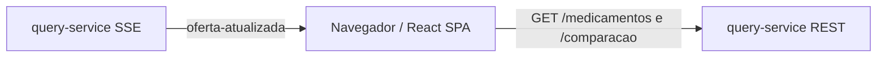

# Comparador web

O `comparador-web/` é a SPA React que apresenta os dez medicamentos carregados dos dados das farmácias. Ela usa TypeScript strict, Vite, Vitest, Testing Library e Biome. O navegador acessa somente o `query-service`.

## Fluxo de dados



A listagem usa `GET /medicamentos?busca=...&categoria=...`; a tela de detalhe usa `GET /medicamentos/:id/comparacao`. Uma conexão `EventSource` compartilhada escuta `oferta-atualizada`. O reducer aplica preço, quantidade e farmácia mais barata à listagem, anuncia a mudança em `aria-live` e destaca o cartão por 1,5 segundo. O detalhe busca a comparação atualizada quando recebe um evento. A reconexão é automática e a conexão é fechada ao desmontar a aplicação.

`GET /medicamentos` retorna `{ itens, page, pageSize, total, totalPages }`; cada item traz `id`, `nome`, `principioAtivo`, `concentracao`, `apresentacao`, `slug`, `dosagem`, `laboratorio`, `registroMS`, `tarja`, `tarjaTipo`, `imagem`, `descricao`, `indicacao`, `modoDeUso`, `contraindicacao`, `avaliacao`, `avaliacoesTotal`, `farmaciaMaisBarata`, `categoria`, os agregados de preço em centavos e `atualizadoEm`. `GET /medicamentos/:id/comparacao` retorna `{ medicamento, ofertas }`; cada oferta traz `farmaciaId`, `farmacia`, `precoCentavos`, `atualizadoEm`, `ehMenorPreco` e `diferencaParaMenorCentavos`.

O evento SSE tem nome `oferta-atualizada`. Seu payload inclui o medicamento e farmácia alterados, preços anterior/atual e menor/maior em centavos, `qtdFarmacias`, `farmaciaMaisBarata`, os dados de exibição, `atualizadoEm`, `correlationId`, `eventId` e a lista `ofertas` com preços e datas ordenados. Erros REST usam `application/problem+json` com campos como `title`, `detail` e `status`.

## Estrutura

| Caminho | Responsabilidade |
|---|---|
| `src/api/` | cliente HTTP e contratos públicos consumidos |
| `src/hooks/` | consulta, comparação e conexão SSE compartilhada |
| `src/lib/` | reducer de ofertas e formatação BRL baseada em centavos |
| `src/components/` | cartões, detalhe e estados de carregamento/erro/vazio |
| `scripts/copiar-imagens.mjs` | copia imagens de `frontend/site1/images/` para `public/medicamentos/` |
| `Dockerfile` | build Vite e nginx com fallback de rota SPA |

O campo `imagem` como `images/losartana.jpg` é convertido em `/medicamentos/losartana.jpg`. A origem permanece em `frontend/` e não é modificada.

## Como executar

Com o backend disponível em `http://127.0.0.1:3000`:

```bash
pnpm -C comparador-web install
pnpm -C comparador-web dev
pnpm -C comparador-web lint
pnpm -C comparador-web test
```

No Compose, a interface fica em `http://127.0.0.1:5173`. O host pode ser alterado por `WEB_HOST_PORT`; a URL do query-service para o bundle é configurada por `VITE_API_URL`. O CORS aceita `127.0.0.1` e `localhost`.

O painel `/demo` fica oculto por padrão e só é compilado quando `VITE_ENABLE_DEMO=true` (variável de ambiente no Vite ou no `.env` usado pelo Compose). Os simuladores bloqueiam a chamada administrativa cross-origin; para demonstrar a mudança ao vivo, rode `pnpm -C backend demo:preco` no terminal. O navegador continua conectado ao SSE e exibe a alteração.
