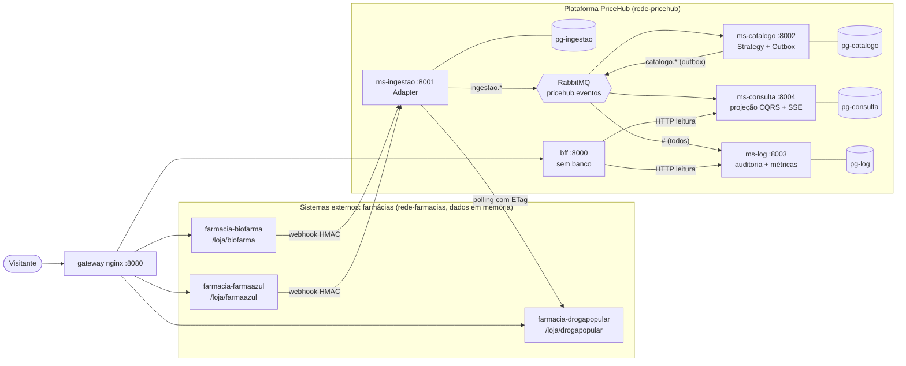

# Plano de reestruturação do PriceHub

Reunião de orientação: 16/11/2026. Prazo do professor Gil para a professora Ângela: **sexta, 20/11**.
Meta do grupo: **quinta, 19/11**, com o sistema rodando e o texto alinhado ao código.

> **Situação (16/11/2026): implementado na versão enxuta.** Diferenças em relação a este plano:
> * 3 microsserviços do PriceHub (ms-ingestao, ms-catalogo, ms-log) em vez de 5, cada um com o seu contêiner PostgreSQL
>   (`pg-ingestao`, `pg-catalogo`, `pg-log`);
> * as farmácias continuam no mesmo `ms-farmacia` (três instâncias), agora com site, `/admin` e simulação programada,
>   servidas pelo gateway em `/loja/<farmácia>/`;
> * vendas, pedidos, vitrines e o app de gestão das lojas foram removidos;
> * a documentação por microsserviço (seção 12) ainda não foi escrita.
>
> Como rodar e o que cada tela faz está no `README.md`.

Este documento é a especificação. O prompt em `PROMPT-CLAUDE-CODE.md` manda o agente executá-la por fases.

---

## 1. O que mudou e por quê

### 1.1 Falas do professor Gil (o que precisa estar no sistema)

| Momento | O que ele disse | Consequência no código |
|---|---|---|
| 29:03 a 29:18 | A loja está "dentro do próprio PriceHub", não parece uma coisa externa | Farmácias saem do `backend/` do PriceHub, ficam em pasta, rede e link próprios |
| 30:04 | Três farmácias, **três links diferentes**, produtos abertos; na farmácia há uma **tela de alteração de preço** que dispara a informação | Cada farmácia tem site próprio com prefixo próprio e uma página `/admin` |
| 31:01 a 32:44 | Compra e "caixa de compra" não têm nada a ver com um agregador de preço; o texto fala de agregação | Remover pedidos, vendas, experimento de compras e vitrines com carrinho |
| 32:49 | "Cadê os microsserviços? Cadê os eventos? Cadê o negócio funcionando?" | O fluxo do negócio tem de ficar visível: loja altera, PriceHub capta, comparador mostra |
| 34:02 | Quem altera o preço é a farmácia; o preço é capturado pela plataforma | A origem de todo evento é uma alteração na farmácia (manual ou programada) |
| 35:35 a 36:32 | A farmácia pode guardar em memória. Metodologia: PriceHub começa zerado, liga a farmácia 1 e ela dispara todos os preços, depois a 2, depois a 3, compara; depois uma farmácia muda um preço e o evento é capturado | Carga inicial ao subir cada farmácia + roteiro de validação em etapas |
| 37:02 | "Vocês só têm um banco de dados" | **Um contêiner PostgreSQL por microsserviço**, visível no `docker compose ps` |
| 39:13, 39:51 a 40:47 | Cada microsserviço precisa de um capítulo: requisitos, contêiner, como a informação chega, eventos de entrada, processamento, saída | Gerar `docs/microsservicos/<servico>.md` com esse roteiro (seção 12) |
| 40:57 | Cada farmácia tem de estar separada | Um contêiner por farmácia, cada uma com URL e identidade própria |
| 48:19 a 48:51 | Telas simples. Uma tela de gestão na farmácia que modifica o valor. O que precisa ser mostrado são os eventos e os microsserviços. Tudo começa com um **evento de negócio** | Comparador enxuto + monitor interno; o evento de negócio é "preço alterado na farmácia" |

### 1.2 O que o grupo combinou depois da reunião

* **Roldão** (34:28, 54:43 a 56:03): usar um *timer* para mudar os preços, com variações que façam sentido
  (20 → 21 → 23, nunca 20 → 50). O comparador mostra os preços, destaca o menor, tem histórico por remédio e, ao
  clicar, leva para a página do remédio na farmácia.
* **Roldão** (01:00:59 a 01:11:28): o monitor de eventos é ferramenta interna; "gestão das lojas" sai; "vitrines"
  vira só uma lista de **farmácias parceiras** com links; 10 remédios; busca não é obrigatória; métricas como maior
  e menor preço praticado.
* **Luis** (01:03:05 a 01:04:42) descreveu a arquitetura do documento com **cinco serviços**: gestão/ingestão,
  catálogo, consulta, log e BFF. **Roldão** (01:05:14): "mantém só isso aí".
* **João** (58:02 a 59:20): cortar vitrine e gestão; usar prefixo nos links; gerar vários preços por produto e ir
  alterando com a aplicação rodando.

### 1.3 Requisitos do produto

| ID | Requisito | Critério de aceite |
|---|---|---|
| RF-01 | Captar os preços das 3 farmácias | Ao subir cada farmácia, os 10 produtos dela aparecem no comparador em até 5 s (webhook) ou 1 ciclo de polling |
| RF-02 | Coletar e guardar os dados | Toda alteração gera uma coleta bruta (`ms-ingestao`) e um registro de histórico (`ms-catalogo`) |
| RF-03 | Mostrar o histórico de alteração dos preços | O detalhe do medicamento tem gráfico por farmácia e tabela "de → para" com horário e origem |
| RF-04 | Mostrar o preço das 3 farmácias e levar à página do produto | Cada oferta tem botão "Ver na farmácia" que abre `/loja/<farmacia>/produto/<slug>` |
| RF-05 | Destacar o preço mais barato | O card e o detalhe marcam a oferta mais barata; o destaque muda ao vivo quando outra farmácia passa a ser a mais barata |
| RF-06 | Cada farmácia altera o próprio preço | `/loja/<farmacia>/admin` edita o preço; a simulação programada usa o mesmo caminho |
| RF-07 | Listar as farmácias parceiras | `/parceiras` lista as 3 com link para o site de cada uma |
| RF-08 | Monitorar os eventos (uso interno) | `/monitor` mostra eventos ao vivo, linha do tempo por `correlationId`, filas e métricas |

Os RNF continuam os da Tabela de RNF do texto (desacoplamento, resiliência, observabilidade, integridade, facilidade de
integração, atualidade). O RNF de desacoplamento passa a valer de forma literal: um banco por serviço, em contêineres
separados.

### 1.4 Referências em vídeo

Só deu para ler os títulos dos vídeos. Cada um serve de base para uma decisão do plano:

* *RabbitMQ: quando usar e quando não?* sustenta a escolha do RabbitMQ (filas, ACK, retry, DLQ) e o descarte do Kafka.
* *Microsserviços: a maior armadilha da arquitetura moderna / DDD* sustenta os contextos delimitados, o banco por serviço
  e a ausência de chamadas HTTP em cadeia entre serviços (para não virar um "monólito distribuído").
* *Arquitetura orientada a eventos: o guia completo para escalar microsserviços* sustenta o evento de negócio como gatilho,
  o *outbox*, a consistência eventual e a projeção de leitura (CQRS).
* *Padrão de projeto Observer* sustenta a farmácia como sujeito e os observadores que avisam o PriceHub.

---

## 2. Arquitetura alvo



### 2.1 Serviços

| Serviço | Porta | Responsabilidade | Banco (contêiner) | Entra | Sai |
|---|---|---|---|---|---|
| `ms-ingestao` | 8001 | Porta de entrada dos dados das farmácias: recebe webhooks, faz polling, converte cada formato no modelo canônico (Adapter), guarda a coleta bruta | `pg-ingestao` (`coletas_brutas`, `estado_do_polling`) | `POST /webhooks/{farmacia}`, polling HTTP | `ingestao.oferta.recebida`, `ingestao.oferta.descartada`, `ingestao.coleta.realizada`, `ingestao.farmacia.indisponivel` |
| `ms-catalogo` | 8002 | Núcleo: associa cada oferta a um medicamento único (Strategy), mantém preço atual e histórico, publica pela outbox | `pg-catalogo` (`medicamentos`, `farmacias`, `ofertas`, `historico_precos`, `outbox`, `eventos_processados`, `ofertas_nao_correspondidas`) | `ingestao.*` | `catalogo.medicamento.cadastrado`, `catalogo.oferta.atualizada`, `catalogo.menor-preco.alterado`, `catalogo.oferta.nao-correspondida` |
| `ms-consulta` | 8004 | Projeção de leitura (CQRS): comparação pronta para a tela, histórico, métricas e tempo real (SSE) | `pg-consulta` (`comparacao_medicamentos`, `comparacao_ofertas`, `historico_projetado`, `farmacias_parceiras`, `eventos_processados`) | `catalogo.*` | REST + SSE de leitura |
| `ms-log` | 8003 | Assina todos os eventos (`#`), rastreia por `correlationId`, mede aceite e convergência, lê o estado das filas | `pg-log` (`registros_de_eventos`) | `#` | REST + SSE para o monitor |
| `bff` | 8000 | Única porta de entrada do frontend: agrega leituras do `ms-consulta` e do `ms-log` no formato de cada tela | **nenhum** (gateway sem estado) | HTTP do frontend | HTTP para `ms-consulta` e `ms-log` |
| `farmacia-*` | 8101 a 8103 | Sistema externo simulado: site, página do produto, `/admin`, simulação programada, Observer | memória | edição de preço (admin ou agendador) | webhook (BioFarma, FarmaAzul) ou arquivo legado (DrogaPopular) |
| `gateway` | 8080 | nginx: serve o build do comparador e do monitor e roteia por prefixo | - | navegador | serviços acima |

**Regras de comunicação:**

* Entre os microsserviços do PriceHub, a comunicação é **só por eventos**.
* O BFF faz apenas leitura HTTP. Ele é a borda e não faz parte do domínio, por isso não tem banco (justificativa para o texto).
* As farmácias só alcançam o `ms-ingestao`. Elas ficam na rede `rede-farmacias`, sem acesso ao RabbitMQ nem aos bancos,
  e não importam `pricehub_common`: um sistema externo não compartilha biblioteca com a plataforma.

### 2.2 O que sai do código

* Pedidos, vendas, compras, estoque e experimento "a mesma compra nos dois modelos": `ms-farmacia/app/api/loja.py`,
  `dominio/pedido.py`, `ms-ingestao/app/servicos/confirmacoes.py`, eventos `*.venda.*`, tabelas e métricas de vendas,
  etapa `compras` do script de validação.
* CRUD de produtos na farmácia. A farmácia só **edita preço** e controla a simulação.
* Reconciliação periódica do `ms-ingestao`. Ficam a carga inicial ao subir, o webhook com retentativas na farmácia e o polling.
* No `ms-catalogo`: rotas de busca e SSE, que passam para o `ms-consulta`. O catálogo fica só com `/saude` e `/admin/consumo/*`.
* No frontend: `apps/lojas` e `apps/vitrines`, as abas de experimento e de comparação com e-commerces do monitor e o carrinho dos sites.
* Banco único `postgres` + `infra/postgres` (init de vários bancos), substituídos por um contêiner por serviço.

### 2.3 Eventos

| Evento | Produtor | Consumidores | Dados principais |
|---|---|---|---|
| `ingestao.oferta.recebida` | ms-ingestao | ms-catalogo, ms-log | farmácia, código do produto na loja, nome, princípio ativo, apresentação, `precoCentavos`, `urlDoProduto`, `origemDaAlteracao` (`carga-inicial`, `manual`, `programada`), `alteradoNaFarmaciaEm` |
| `ingestao.oferta.descartada` | ms-ingestao | ms-log | motivo da rejeição (validação) |
| `ingestao.coleta.realizada` | ms-ingestao | ms-log | farmácia, tipo (webhook/polling), quantidade, mudou? |
| `ingestao.farmacia.indisponivel` | ms-ingestao | ms-log | farmácia, erro |
| `catalogo.medicamento.cadastrado` | ms-catalogo | ms-consulta, ms-log | id, nome, princípio ativo, apresentação, categoria, imagem |
| `catalogo.oferta.atualizada` | ms-catalogo | ms-consulta, ms-log | medicamento, farmácia (id, nome, URL da loja), preço anterior e novo, `urlDoProduto`, origem, horário |
| `catalogo.menor-preco.alterado` | ms-catalogo | ms-consulta, ms-log | medicamento, farmácia e preço anteriores e novos |
| `catalogo.oferta.nao-correspondida` | ms-catalogo | ms-log | oferta que a Strategy não conseguiu associar |

O envelope (`idDoEvento`, `tipo`, `versao`, `ocorridoEm`, `correlationId`, `servicoDeOrigem`, `dados`), as filas
duráveis com `.retry` e `.dlq` e o consumidor idempotente continuam como estão. O `correlationId` nasce na farmácia,
no momento da alteração, e é propagado pelo cabeçalho `X-Correlation-Id` do webhook (ou gravado no arquivo legado).

Os eventos de catálogo levam todo o estado de que o `ms-consulta` precisa (*event-carried state transfer*). Assim o
`ms-consulta` nunca chama o catálogo. Para reconstruir a projeção (por exemplo, se o `ms-consulta` subir depois):
`ms-consulta` publica `consulta.reconstrucao.solicitada` e o `ms-catalogo` responde republicando o estado atual com
`dados.reenvio = true`.

---

## 3. Bancos de dados

Um serviço `postgres:16-alpine` por microsserviço, cada um com volume próprio e porta exposta só para inspeção:

| Contêiner | Banco | Dono | Porta no host |
|---|---|---|---|
| `pg-ingestao` | `ingestao` | ms-ingestao | 5441 |
| `pg-catalogo` | `catalogo` | ms-catalogo | 5442 |
| `pg-log` | `auditoria` | ms-log | 5443 |
| `pg-consulta` | `consulta` | ms-consulta | 5444 |

Opcional, no perfil `ferramentas`: um contêiner `adminer` em `:8090` para mostrar as tabelas de cada banco na apresentação
(`docker compose --profile ferramentas up -d adminer`).

---

## 4. Roteamento (gateway em `http://localhost:8080`)

| URL | Destino | Quem usa |
|---|---|---|
| `/` | Comparador (lista dos 10 medicamentos) | visitante |
| `/medicamento/{id}` | Detalhe: 3 preços, mais barato em destaque, histórico, métricas, links | visitante |
| `/parceiras` | Lista das farmácias parceiras com link para cada site | visitante |
| `/monitor`, `/monitor/eventos`, `/monitor/filas`, `/monitor/metricas` | Monitor interno | grupo e banca |
| `/api/comparador/*`, `/api/monitor/*` | BFF | frontend |
| `/loja/biofarma/` | Site da BioFarma Verde | cliente da farmácia |
| `/loja/biofarma/produto/{slug}` | Página do produto na BioFarma (destino do "Ver na farmácia") | cliente da farmácia |
| `/loja/biofarma/admin` | Edição de preço e controle da simulação da BioFarma | operador da farmácia |
| `/loja/biofarma/api/*` | API da BioFarma (site, admin e formato próprio de integração) | site da loja |
| `/loja/farmaazul/...`, `/loja/drogapopular/...` | Mesma estrutura para as outras duas | |
| `/rabbitmq/` | Painel do RabbitMQ (opcional) | grupo |

**Detalhes de implementação do gateway:**

* O nginx remove o prefixo `/loja/<farmacia>` antes de repassar para `farmacia-<farmacia>:81xx`.
* Cada site injeta `<base href="/loja/<farmacia>/">` a partir da variável `PREFIXO_PUBLICO`, e todos os links e `fetch`
  são relativos (sem barra inicial). Assim o mesmo site funciona com o gateway ou direto na porta 81xx.
* SSE pelo nginx: `proxy_buffering off`, `proxy_cache off`, `proxy_read_timeout 1h` e `X-Accel-Buffering: no` nas rotas `tempo-real`.
* Comparador e monitor rodam em produção como build estático servido pelo próprio gateway. O build multi-stage
  substitui o contêiner `frontend` com o Vite dev. O monitor usa `base: '/monitor/'`.
* Os SPAs precisam de fallback para `index.html` (`try_files $uri /index.html`).
* Cada serviço continua com a própria porta para o Swagger (`:8000/docs`, `:8001/docs` ...).
* Para publicar num domínio depois, o mesmo nginx pode mapear subdomínios (`biofarma.<dominio>`) para as mesmas lojas.
  Essa troca é só de configuração.

---

## 5. Farmácias (sistemas externos)

### 5.1 Origem do frontend

Usar os três sites que já existiam no repositório: `C:\Desenvolvimento\faculdade\tcc\frontend\site1`, `site2-azul` e
`site3-vermelho`, gerados a partir de `frontend/PROMPT.txt`. Eles já têm identidade visual própria (verde, azul,
vermelho), página de produto, bula, imagens locais e o `slug` de cada remédio.

Ajustes:

1. Mover para `farmacias/sites/biofarma`, `farmacias/sites/farmaazul` e `farmacias/sites/drogapopular`.
2. Trocar o `products.js` estático por `fetch('api/produtos')`. O preço vem da memória da farmácia e muda ao vivo.
3. Remover carrinho, drawer, frete, checkout, recibo e `localStorage` do carrinho.
4. Página do produto em `produto/{slug}`, com preço atual e "atualizado às hh:mm:ss". Ela recarrega o preço a cada
   poucos segundos ou por SSE da própria loja.
5. Nova página `admin` em cada site, no mesmo visual da loja:
   * tabela dos 10 produtos com preço atual, campo para novo preço (em reais, convertido para centavos) e botão salvar;
   * painel **Simulação programada**: ligada/desligada, intervalo (1, 3, 5, 10, 30 s), posição atual (ex.: 132 de
     1000) e as últimas 10 alterações com a origem (manual/programada);
   * botão "Restaurar preços iniciais".

### 5.2 Backend da farmácia

* Mover `backend/services/ms-farmacia` para `farmacias/servidor/`, com Dockerfile próprio e sem depender de
  `pricehub_common`. O código continua sendo um só, rodando em três instâncias configuradas por `FARMACIA_ID`.
* Manter o **Observer**: `CatalogoDaFarmacia` é o sujeito; `alterar_preco(sku, centavos, origem)` notifica os
  observadores. O `ObservadorWebhook` (BioFarma, FarmaAzul) envia o webhook assinado; o `ObservadorArquivoLegado`
  (DrogaPopular) reescreve o arquivo consultado pelo polling.
* Manter os três formatos de integração diferentes (é o que justifica o Adapter): BioFarma em camelCase e reais,
  FarmaAzul paginada em centavos, DrogaPopular em arquivo legado. Os três passam a incluir o link público do produto,
  cada um no seu formato (ex.: `linkProduto`, `url_produto`, coluna `URL`).
* `URL_PUBLICA` (ex.: `http://localhost:8080/loja/biofarma`) monta o link do produto.
* Ao subir, a farmácia envia a carga inicial (`origem = carga-inicial`). Isso reproduz a metodologia do professor:
  liga a farmácia 1, todos os preços chegam; depois a 2; depois a 3.

---

## 6. Simulação programada de preços

### 6.1 Geração dos 100 preços

Criar `scripts/gerar_precos_programados.py`, que grava `farmacias/servidor/app/dados/precos_programados.json` no formato
`{farmacia: {sku: [100 preços em centavos]}}`. Esse arquivo é versionado, então a simulação é reproduzível.

* **Passeio aleatório com semente fixa** (`--semente 2026`). A cada passo, o preço varia de 0,5 % a 4 % para cima ou
  para baixo, nunca repete o valor anterior e fica dentro de ±18 % do preço inicial daquela farmácia (rebate no limite).
* **Arredondamento comercial:** o final fica em ,49 / ,90 / ,99 (ex.: 14,90 → 15,49 → 14,99). É a "mudança que faz
  sentido" pedida pelo Roldão.
* **Faixas que se cruzam:** com ±18 %, a FarmaAzul às vezes fica abaixo da DrogaPopular e a BioFarma às vezes abaixo
  da FarmaAzul. Assim, a farmácia mais barata **troca durante a demonstração**, e o destaque e o evento
  `catalogo.menor-preco.alterado` aparecem na prática.
* O script imprime um resumo: mínimo, máximo e quantas vezes a mais barata troca por medicamento.

### 6.2 Agendador na farmácia

* Uma tarefa assíncrona por farmácia percorre os 10 produtos em rodízio. A cada tick, aplica o próximo dos 100 preços
  daquele produto chamando **o mesmo `alterar_preco` da tela de admin**, com `origem = programada`. Para o PriceHub, é
  exatamente uma edição feita pela loja.
* Ao chegar no 100º preço, volta percorrendo a lista ao contrário, para não haver salto do último para o primeiro.
* Controle por `GET/PUT api/admin/simulacao` (`ativa`, `intervaloS`, `posicao`) e pela página `/admin`.
* Variáveis: `SIMULACAO_ATIVA` (padrão `true`), `INTERVALO_DA_SIMULACAO_S`, `ATRASO_INICIAL_DA_SIMULACAO_S`
  (padrão 20 s, para a carga inicial chegar antes).

### 6.3 Escolha do intervalo: 5 s

| Intervalo por farmácia | Alterações/min (3 farmácias) | Eventos/min no RabbitMQ (aprox.) | Pontos de histórico por produto e farmácia em 15 min | Avaliação |
|---|---|---|---|---|
| 1 s | 180 | ~400 | 90 | só para "encher" histórico antes da banca (modo acelerado) |
| 3 s | 60 | ~130 | 30 | o monitor rola rápido demais para narrar evento por evento |
| **5 s** | **28** (5 s + 5 s + 15 s) | **~70** | **18** | **padrão**: dá para acompanhar cada evento ao vivo e o gráfico fica cheio em minutos |
| 10 s | 14 | ~35 | 9 | lento para a demonstração; histórico ralo |

Padrão adotado:

* **BioFarma** e **FarmaAzul**: a cada **5 s**, com a FarmaAzul defasada em 2 s para os eventos não coincidirem.
* **DrogaPopular**: a cada **15 s**, com o polling do `ms-ingestao` a cada **5 s**. Como o polling é mais rápido que a
  alteração, toda mudança é captada e o histórico fica completo. A métrica de aceite x convergência ainda mostra a
  diferença entre webhook (milissegundos) e polling (até 5 s).
* Antes da banca, colocar 1 s por alguns minutos (pelo `/admin` ou pelo script) gera um histórico grande. Depois, voltar para 5 s.

Um ciclo completo dura 10 produtos × 100 preços × 5 s ≈ 83 min por farmácia.

---

## 7. Frontend do PriceHub

Use a skill `frontend-sem-cara-de-ia` nas telas: interface simples e direta, sem banner, sem texto de marketing.

### 7.1 Comparador (público)

* **`/` (lista):** os 10 medicamentos em cards. Cada card mostra nome, apresentação, **menor preço em destaque** com a
  farmácia e os três preços em linha. A oferta mais barata tem selo; as outras mostram a diferença em relação a ela.
  Seta ↑/↓ da última variação e "atualizado há Xs". O card pisca quando chega um evento por SSE. A busca simples por
  nome é opcional e só no cliente.
* **`/medicamento/{id}` (detalhe):**
  * as 3 ofertas ordenadas da mais barata para a mais cara, com destaque, e botão **"Ver na <farmácia>"**
    (`urlDoProduto`, nova aba);
  * **gráfico do histórico** com uma linha por farmácia (degrau, eixo do tempo);
  * métricas: menor e maior preço praticado (geral e por farmácia), preço médio atual, número de alterações, última
    alteração e economia (mais caro − mais barato);
  * tabela das últimas alterações: horário, farmácia, de → para, variação % e origem (manual, programada ou carga inicial).
* **`/parceiras`:** as 3 farmácias, com nome, forma de integração (webhook ou polling), número de ofertas, última
  atualização e link para o site.
* Estado vazio: "Nenhuma farmácia conectada ainda". Essa é a etapa 1 da metodologia do professor.

### 7.2 Monitor (interno, `/monitor`)

Três abas, sem o resto:

1. **Eventos:** lista ao vivo filtrável por farmácia e tipo. Ao clicar, abre a linha do tempo da operação
   (`correlationId`): farmácia → ms-ingestao → RabbitMQ → ms-catalogo → ms-consulta, com o tempo de cada passo.
   Botão "Exportar JSON".
2. **Filas e serviços:** saúde dos 5 serviços e dos 4 bancos, profundidade de cada fila (`.retry` e `.dlq` também),
   botões pausar/retomar o consumo do `ms-catalogo` e do `ms-consulta` (demonstração de resiliência) e links para o
   Swagger de cada serviço e o `/admin` de cada farmácia.
3. **Métricas:** tempo de aceite x janela de convergência (mediana e p95), webhook x polling, eventos por minuto,
   alterações por farmácia e trocas de farmácia mais barata.

---

## 8. Estrutura de pastas alvo

```
backend/                     PriceHub (a plataforma)
  libs/pricehub_common/      envelope, contratos, barramento RabbitMQ, logs, SSE, fábrica FastAPI
  services/ms-ingestao/
  services/ms-catalogo/
  services/ms-consulta/      novo
  services/ms-log/
  services/bff/              novo
farmacias/                   sistemas externos (não fazem parte do PriceHub)
  servidor/                  FastAPI único, 3 instâncias por FARMACIA_ID; Observer; agendador
  sites/biofarma|farmaazul|drogapopular/
frontend/                    comparador e monitor (npm workspaces)
  apps/comparador/
  apps/monitor/
  packages/api/  packages/ui/
gateway/                     nginx.conf + Dockerfile (build dos apps + proxy)
scripts/                     gerar_precos_programados.py, validacao_ponta_a_ponta.py, simulacao.py
docs/microsservicos/         um arquivo por serviço (base dos capítulos do TCC)
docker-compose.yml
```

---

## 9. Fases de implementação

Cada fase termina com: testes verdes (`backend/executar_testes.sh`, `ruff check .`, `npm run verificar-tipos`),
`docker compose up -d --build` com tudo *healthy*, a verificação descrita na fase e um commit semântico em português.

| Fase | Entrega | Pronto quando |
|---|---|---|
| F0 | Preparação | Estado do git conferido (veja a seção 11), linha de base dos testes registrada |
| F1 | Enxugar | Compras, vendas, pedidos, CRUD, reconciliação, `apps/lojas` e `apps/vitrines` removidos; testes verdes; o fluxo de preço continua funcionando |
| F2 | Banco por serviço | 4 contêineres `pg-*`; `docker compose ps` mostra cada um *healthy*; cada serviço só conhece a própria URL de banco |
| F3 | `ms-consulta` (CQRS) | Projeção alimentada só por eventos; rotas de leitura e SSE saem do catálogo; `catalogo.menor-preco.alterado` publicado; reconstrução por evento funciona |
| F4 | BFF + gateway | `http://localhost:8080` serve o comparador e o monitor; `/api/*` passa pelo BFF; SSE funciona através do nginx |
| F5 | Farmácias externas | Pasta `farmacias/`, rede separada, sites do Davi adaptados, `/loja/<f>/`, `/loja/<f>/produto/<slug>` e `/loja/<f>/admin` funcionando; editar no admin atualiza o comparador |
| F6 | Simulação programada | JSON dos 100 preços gerado e versionado; agendador com controles; em 2 min de execução, cada produto tem histórico nas 3 farmácias e a mais barata troca pelo menos uma vez |
| F7 | Telas do PriceHub | Comparador, detalhe com gráfico e métricas, parceiras e monitor com 3 abas, conforme a seção 7 |
| F8 | Validação e documentação | Script de validação atualizado, prints novos com Playwright, `docs/microsservicos/*.md`, README e diagramas atualizados |

---

## 10. Validação (metodologia do professor)

Atualizar `scripts/validacao_ponta_a_ponta.py` para gravar evidências em `docs/evidencias/<data-hora>/`:

| Etapa | Comando | O que comprova |
|---|---|---|
| `etapa1` | só a plataforma no ar | comparador vazio, filas vazias, 4 bancos vazios |
| `etapa2` | sobe `farmacia-biofarma`, depois `farmaazul`, depois `drogapopular` | após cada uma: 10, 20 e 30 ofertas; 10 medicamentos únicos; carga inicial rastreável |
| `etapa3` | altera 1 preço pelo admin (simulação desligada) | o evento sai da farmácia, passa pelos serviços e chega ao comparador; tempo de aceite e convergência |
| `simulacao --minutos 5` | simulação ligada | número de alterações, histórico por produto, trocas da mais barata, nenhuma mensagem na DLQ |
| `resiliencia` | pausa o consumo do `ms-catalogo` com a simulação ligada | as farmácias continuam sendo atendidas, a fila cresce; ao retomar, esvazia e nada se perde |

Testes de tela com a skill `playwright` cobrindo: lista com 10 cards e 3 preços; destaque da mais barata; "Ver na
farmácia" abre `/loja/<f>/produto/<slug>`; edição no `/admin` altera o card em até 2 s (webhook) ou 6 s (polling);
linha do tempo de um `correlationId` no monitor. Os prints vão para `docs/passo-a-passo/`, substituindo os antigos.

---

## 11. Riscos e pendências

* **Git:** a pasta `pricehub/` não tem `.git` próprio e aparece como não rastreada no repositório pai
  (`C:\Desenvolvimento\faculdade\tcc`). O README aponta para `github.com/joaoramosw/PriceHub-backend`. Antes da F1,
  confirmar onde versionar (clonar o remoto ou `git init`) e fazer um commit do estado atual, para poder voltar atrás.
* Os sites do Davi carregam fontes e ícones de CDN. Sem internet, a página pode ficar sem ícones. Vale baixar os
  arquivos e servir localmente.
* A porta 8080 pode estar ocupada. Usar a variável `PORTA_DO_GATEWAY` no `.env`.
* Contêineres antigos `pricehub-tcc-*` e `pricehub-*` com volumes antigos: rodar `docker compose down -v --remove-orphans`
  antes de subir a nova versão.
* O texto do TCC precisa acompanhar: 5 serviços, 4 bancos, BFF sem banco e farmácias externas. A seção 12 gera a base.

---

## 12. Documentação por microsserviço (base dos capítulos)

Gerar `docs/microsservicos/README.md` (índice, diagrama de contêineres em Mermaid e a "história" do capítulo 4: do
evento de negócio "a farmácia alterou o preço" até o comparador) e um arquivo por serviço (`ms-ingestao.md`,
`ms-catalogo.md`, `ms-consulta.md`, `ms-log.md`, `bff.md`, `farmacias.md`), sempre com as seções que o professor
listou (39:51 a 40:47):

1. Responsabilidade (uma frase) e por que é um serviço separado
2. Requisitos atendidos (RF/RNF da seção 1.3)
3. Contêiner: imagem, porta, variáveis de ambiente, *healthcheck*
4. Banco: contêiner, tabelas, campos principais e por que esses dados ficam aqui
5. Entradas: rotas HTTP e/ou filas, *routing keys* e exemplo de payload
6. Processamento: passo a passo e padrões usados (Adapter, Strategy, Outbox, Observer, CQRS, idempotência)
7. Saídas: eventos publicados (com exemplo do envelope) e respostas HTTP
8. Com quem se comunica e com quem **não** se comunica
9. Como verificar: Swagger, comando `curl` e o que olhar no monitor

Incluir também um diagrama de sequência da alteração de preço (Mermaid `sequenceDiagram`) com os tempos medidos numa
execução real. Os textos devem ser factuais e tirados do código, sem frases de efeito: o grupo vai reescrever no LaTeX.
